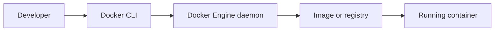
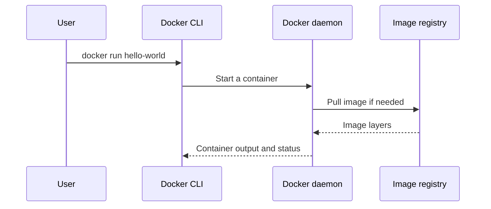
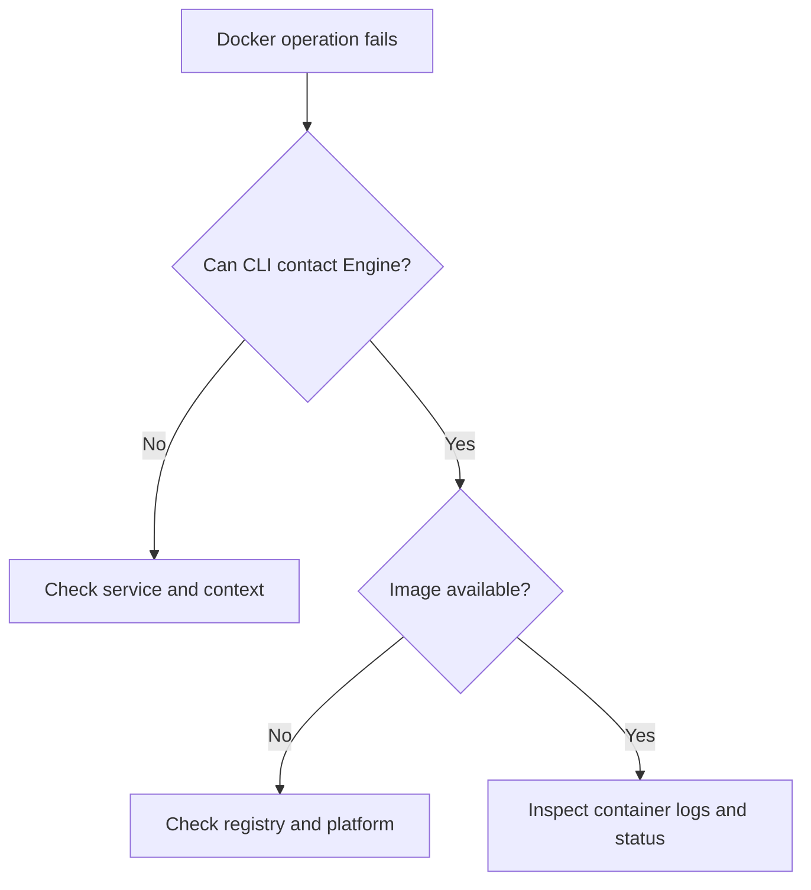

# Why Use Docker? — Explained Simply

*Docker and Kubernetes Study Notes · Author: Jayesh Sharma*

**Section 1: Dive Into Docker! · Lecture 2**

> The title and public curriculum overview are verified from the Udemy course. The actual enrolled lecture video/transcript was not accessible. This is an original topic-based study companion, not a transcript-derived summary. The contents of any downloadable instructor resources remain unverified.

## Contents

- [Overview](#overview)
- [Architecture diagram](#architecture-diagram)
- [Without Docker](#without-docker)
- [With Docker](#with-docker)
- [Limits](#limits)
- [Hands-on exercises](#hands-on-exercises)
- [Troubleshooting](#troubleshooting)
- [Revision questions](#revision-questions)

## Overview

**Reducing environment differences.** Docker packages application dependencies in an image, making running software more repeatable across compatible environments. The public synopsis uses Redis as an example.

**Simple analogy:** An image is like a prepared recipe and boxed ingredients; a running container is one meal prepared from it. You can make multiple containers from one image.

## Architecture diagram





## Without Docker

Different machine dependencies and versions lead to installation failures.

**Why it matters:** Understanding this concept makes debugging and secure deployment easier.

## With Docker

Distribute a versioned image that bundles the application and its required runtime files.

**Why it matters:** Understanding this concept makes debugging and secure deployment easier.

## Limits

An image does not remove external dependencies, architecture requirements, networking and secret-management needs.

**Why it matters:** Understanding this concept makes debugging and secure deployment easier.

## Hands-on exercises

1. Read the corresponding [official Docker documentation](https://docs.docker.com/).
2. Draw the client, daemon, image and container in your own words.
3. Verify Docker Engine is installed and running in an isolated learning environment.
4. Execute the following commands and predict the outcome before each one.
5. Explain whether the image was already cached and why the container finished.

```bash
docker version
docker info
docker run --rm hello-world
docker image ls
docker ps -a
```

**Safety:** Do not share Docker daemon access or mount the host Docker socket into untrusted containers. For installation or resource lectures, follow your course account's authorized materials and the current official setup guide.

## Troubleshooting

| Problem | First check |
|---|---|
| Cannot connect to Docker daemon | Engine running? Correct Docker context? |
| Image not found | Image name, registry access, platform compatibility |
| Container exits | Exit code, application logs, startup command |
| Docker command denied | User permissions and daemon security |
| Different results on two computers | OS/CPU, image tag, environment, volumes |



## Revision questions

1. What is the difference between a Docker image and a running container?
2. Why does a Linux container on macOS generally require a Linux VM?
3. How do the Docker CLI and Docker daemon cooperate?
4. Why is a container not the same as a complete virtual machine?
5. What would you inspect when a Docker command fails?

**Takeaway:** Docker packages application dependencies in an image, making running software more repeatable across compatible environments. The public synopsis uses Redis as an example.

### References

- [Docker and Kubernetes course curriculum](https://www.udemy.com/course/docker-and-kubernetes-the-complete-guide/)
- [Docker Engine documentation](https://docs.docker.com/engine/)
